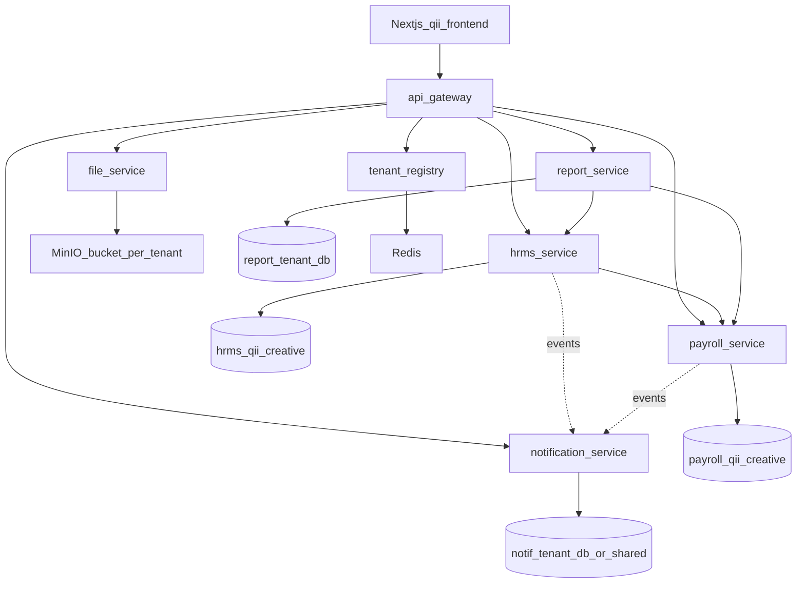

# Qii HRMS v1 — full implementation plan

## North star (non-negotiable)
- **Reusable + configurable** multi-tenant platform: business differences = **tenant DB config/seed**, never `if (tenantId == qii)`.
- **One codebase** serves TechShop, Impit, Qii; Qii is the first **full product** tenant.
- APIs follow **real list standards**: pagination, sorting, searching, filtering — shared platform utilities, same contract on every list endpoint.
- **No build** until you explicitly approve/execute this plan.

## Locked decisions

| Topic | Choice |
|---|---|
| Tenant | `qii_creative` |
| Auth | Open **account picker** → JWT (no Google, no password); full RBAC server-side |
| JWT | `tenant_id`, `employee_id`; roles/permissions resolved server-side each request (fresh revoke) |
| Files | One MinIO; **bucket per tenant** at provision; **file-service** + HRMS metadata |
| Notifications | **notification-service**, in-app only (poll); no email |
| Reports | **report-service**, generate/store + CSV; in-app view/download |
| Frontend | Next.js+TS+Zod, Docker, `TENANT_ID=qii_creative`, Gateway only |
| Seed | Rich cast (Q5 B); always **Asman = Super Admin** |
| Q6 defaults | Work-log Block; BD Sun–Thu 10–18 grace 15; AU separate; team leave alert max 1; payroll balance-first Casual→Annual; poll notifications; monthly report on 1st + on-demand |
| Skip | Google OAuth, email SMTP, hiring, KPI, tax/PF, bank files, native apps, FX |

## Target architecture



### Service responsibilities
- **Gateway**: JWT verify, inject `X-Tenant-ID` (+ optional `X-Employee-ID` from claims), route `/hrms`, `/payroll`, `/files`, `/notifications`, `/reports`, `/api/registry`.
- **Registry**: provision tenant DBs + migrate + seed pack + **create MinIO bucket/policy**; account-picker token issue for tenant.
- **HRMS** (modular monolith, packages by domain): identity/RBAC, org, employees, schedules/attendance, tasks/worklogs, leave, documents metadata, checklists, holidays, settings, audit emit.
- **Payroll**: salary history, draft/finalize/reopen, config-driven absence/hourly rules; gRPC/REST to HRMS for attendance/leave facts.
- **file-service**: presign upload/download; tenant bucket isolation; max 10MB; PDF/JPG/PNG/DOCX.
- **notification-service**: inbox CRUD, dedupe_key, mark read; consume domain events (Redis stream or HTTP event hook v1).
- **report-service**: monthly attendance report jobs + on-demand; CSV exporters; reads HRMS/Payroll APIs with service credentials.

## Shared platform standards (every list API)

Introduce in `platform-common` (or HRMS starter reused by new services):

**Query contract (example):**
- `page` (1-based), `size` (default 20, max 100)
- `sort` = `field,asc|desc` (multi via repeated param)
- `q` = free-text search (entity-defined fields)
- `filter.<field>` = equality/in/range as declared by resource metadata

**Response:**
```json
{ "content": [], "page": 1, "size": 20, "totalElements": 0, "totalPages": 0, "sort": "..." }
```

**Implementation:** Spring `Pageable` + specification/Criteria builders driven by allow-listed fields per resource (not raw SQL from client). Same pattern in file/notification/report services. Frontend Zod schemas match this envelope.

## RBAC model (config in tenant DB)

- Tables: `roles`, `permissions` (feature, action), `role_permissions` (scope: OWN|TEAM|ALL), `user_roles`.
- System roles: Super Admin, Admin, HR, Manager, Employee (seed matrix ≈ SRS Appendix B).
- Interceptor/aspect: `@RequiresPermission(feature, action)` + scope resolver via reporting hierarchy (effective dated lines).
- Nav/API: hide on FE; **always enforce on BE**.

## HRMS domain modules (Qii seed configures; engines generic)

1. **Org**: departments, teams (lead, max_on_leave, clash_action), locations (TZ, currency, calendar).
2. **Employees**: QII-0001 codes, personal vs employment fields, history, status machine, documents metadata.
3. **Schedules**: location → team → employee override; fixed vs hourly.
4. **Attendance**: check-in/out, IP/device/geo optional, status codes Appendix A, corrections + manager approve.
5. **Tasks / work logs**: 15-min steps; checkout Block/Flag from settings.
6. **Leave**: categories with applies_to, chains (manager/mom/person/role), team limit, balances/ledger, half-day, attachments via file-service.
7. **Holidays / checklists / settings / audit**.

## Payroll upgrades
- Config: per-day divisor (working-days vs 30), absence cover category order, unpaid always deduct.
- Finalize locks snapshot; covered absences → leave balance adjustments; reopen reverses.
- Export CSV via report-service or payroll export endpoint (same CSV standard).

## Frontend (`frontend/qii-hrms` or `apps/qii-web`)
- App Router, TS, Zod, TanStack Query (or fetch wrappers), IBM Plex look from prototype.
- Routes grouped Me / Team / HR / Settings per prototype + permission gates.
- Account picker page → `POST /api/registry/token` (or `/auth/demo-session`) with `tenantId` + `employeeId`.
- All data via Gateway base URL; Zod parse list envelopes.

## Provisioning `qii_creative`
1. Create HRMS + Payroll DBs, Liquibase.
2. Create MinIO bucket + access policy; store routing/file endpoint in registry.
3. Seed: locations BD+AU, org, roles/matrix, Asman Super Admin, rich employees/teams, schedules, leave categories, holidays, opening balances, salaries, notification switches, settings.
4. Publish Redis routing for all services.

## Delivery phases (execution order when approved)
1. Platform foundation (JWT picker, RBAC, PageQuery, audit, MinIO provision hook)
2. Org + employees + seed Asman/rich cast
3. Attendance + tasks/work logs
4. Leave + file-service + documents
5. Payroll upgrade
6. notification-service + report-service + Gateway
7. Next.js full UI
8. SRS acceptance smoke + keep TechShop/Impit healthy

## Explicit non-goals in this build
- SMTP email, Google OAuth, multi-tenant frontend switcher, separate MinIO per tenant process, WebSockets.

## Runbook (local)
```bash
docker compose up -d redis postgres-registry postgres-hrms postgres-payroll
./gradlew :tenant-registry:bootRun   # :8080
./gradlew :hrms-service:bootRun      # :8081
./gradlew :payroll-service:bootRun   # :8082
./gradlew :notification-service:bootRun  # :8083
./gradlew :file-service:bootRun      # :8084
./gradlew :report-service:bootRun    # :8085
./gradlew :api-gateway:bootRun       # :8090
bash scripts/provision-qii.sh
cd frontend/qii-hrms && npm run dev   # TENANT_ID=qii_creative → Gateway
```
Postman: `docs/postman/Qii_HRMS.postman_collection.json`. Login as **Asman Rahman** (SUPERADMIN).
